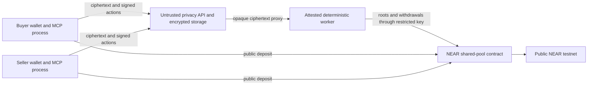

# Security, privacy, and threat model

## Architecture and trust boundary

Buyer and seller clients own wallet signing keys, MCP tokens, and message/product
encryption keys. The untrusted API stores authenticated ciphertext and token hashes.
The TEE alone decrypts signed final terms and maintains the private ledger. The NEAR
contract holds pooled funds and accepts roots and withdrawals only from the
registered worker account.

## What remains private

- plaintext negotiation messages;
- plaintext structured terms;
- the mapping from a private deal to its exact price and collateral split;
- product or service delivery payloads;
- internal available and locked balances;
- deposit secrets and the link created when a party privately claims a commitment;
- MCP tokens and all signing/encryption private keys.

## What remains public or observable

- deposit and withdrawal accounts, amounts, commitments, timestamps, and
  transactions;
- pool contract balance and liability;
- ledger roots and monotonically increasing root sequence;
- TEE worker account, restricted public key, workload hash, and encryption-key hash;
- network timing, request sizes, endpoints, and availability;
- API-visible wallet identity after authentication, token policy amounts, roles,
  opaque references, public encryption keys, and ciphertext sizes.

Pooling and batched roots reduce direct deal correlation. They do not provide
zero-knowledge privacy for deposits or withdrawals. Reusable balances should be
funded before negotiation so a deposit is less likely to reveal a specific price or
deal timing.

## Security invariants

1. A deal is created only after two valid wallet keys sign byte-identical canonical
   terms for BUYER and SELLER roles.
2. Nonces and expiries prevent replay and stale authorization.
3. Amounts are unsigned atomic-unit integer strings at TypeScript boundaries and
   checked `u128` inside the contract.
4. The API cannot decrypt terms, modify a signed action, settle a deal, or authorize
   a withdrawal.
5. The worker key is the only key on its account and can call only
   `anchor_ledger_root` and `withdraw` on one contract.
6. The contract checks the worker predecessor, current root, expiry, amount limits,
   liability, and withdrawal replay state.
7. Every sensitive private-ledger transition is saved in an authenticated encrypted
   snapshot. Roots are batched and withdrawals force a current root.
8. Clients verify the final on-chain worker policy and fresh attestation before
   encrypting private data.
9. Development attestation cannot start in production.
10. NLP, an LLM, and the legacy middleman have no authority in the NEAR path.

## Threat table

| Threat | Control | Residual risk |
| --- | --- | --- |
| Malicious API host reads stored data | AES-256-GCM state file; end-to-end envelopes | Host still sees timing, sizes, wallet authentication, roles, and policy metadata |
| API changes terms or actions | Wallet signatures bind canonical payload, role, identity, nonce, and expiry | Compromised wallet keys can authorize bad requests |
| Buyer and seller submit different terms | Deterministic exact comparison returns `NO_MATCH` | Agents must renegotiate and submit a new round |
| Worker image substitution | Digest-pinned compose plus quote/event-log verification and on-chain hash pinning | TEE vendor, verifier, firmware/TCB policy, and measurement process remain trusted |
| Worker transaction key theft | Encrypted CVM provisioning; one exact function-call key; startup key audit | A compromised running TEE can still use its allowed methods until rotation/pause |
| Unauthorized contract withdrawal | Predecessor check, current-root binding, expiry, limits, liability, replay protection | Registered worker is trusted for private-ledger correctness |
| Snapshot rollback | On-chain root/sequence reconciliation and authenticated snapshot | Batched interval is the maximum normal unanchored window |
| Seller does not deliver | Signed delivery deadline transfers seller collateral to buyer | No oracle judges product quality beyond buyer confirmation/timeout rule |
| Buyer does not confirm | Signed confirmation timeout auto-releases to seller | Scheduled execution may be delayed by worker/network downtime |
| Host blocks requests | Health checks and restart recovery | Confidential compute cannot prevent censorship or denial of service |
| Chain observer correlates a deal | Reusable pool balances and batched roots | Deposits, withdrawals, amounts, accounts, and timing are still public |
| Secret enters repository or evidence | Ignore rules, placeholder-only examples, secret scanner, redacted evidence | Human screenshots or external tools can still leak secrets |

## Operational response

- Pause the contract if the worker, attestation, snapshot, or withdrawal behavior is
  suspect.
- Revoke affected MCP tokens and rotate client encryption/signing material.
- Use delayed worker rotation for planned changes.
- Use seven-day emergency recovery only when the active worker cannot be recovered.
- Keep the pool paused during emergency recovery and verify the replacement workload
  before resuming.
- Preserve public transaction hashes, verifier output, and redacted logs for review.
